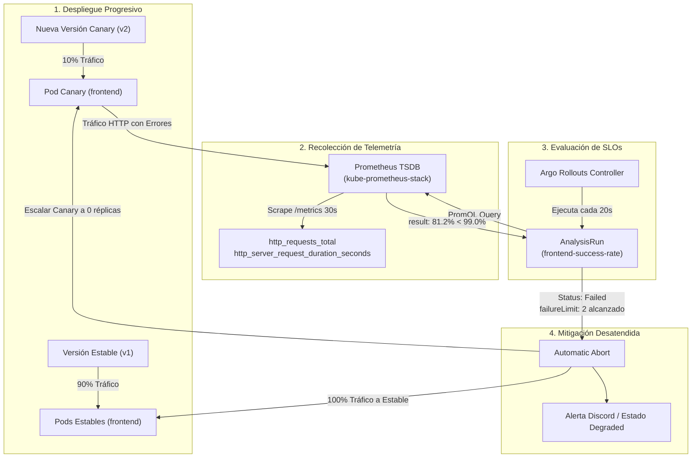

# Análisis Automático del Canary con Prometheus (P4-07)

> **Referencia de tarea:** `P4-07` (#46) — *Análisis automático del canary con Prometheus*  
> **Cierre de arquitectura:** Cierra el ciclo iniciado en `P3-06` (Entrega progresiva con Argo Rollouts). El rollback lo decide la métrica de Prometheus, no una persona.

---

## 1. Arquitectura del Ciclo de Retroalimentación SRE



---

## 2. Definición del `AnalysisTemplate` (`analysis-templates.yaml`)

El recurso `AnalysisTemplate` define el umbral de aceptación del Service Level Objective (SLO):

```yaml
apiVersion: argoproj.io/v1alpha1
kind: AnalysisTemplate
metadata:
  name: frontend-success-rate
  namespace: online-boutique
spec:
  args:
    - name: service-name
      value: frontend
  metrics:
    - name: success-rate
      interval: 20s
      count: 5
      successCondition: len(result) == 0 || result[0] >= 0.99
      failureLimit: 2
      provider:
        prometheus:
          address: http://kube-prometheus-stack-prometheus.monitoring.svc.cluster.local:9090
          query: |
            (
              sum(rate(http_requests_total{service="{{args.service-name}}", status!~"5.*"}[1m]))
              or
              sum(rate(http_server_request_duration_seconds_count{service="{{args.service-name}}", http_status_code!~"5.*"}[1m]))
              or
              sum(rate(app_requests_total{service="{{args.service-name}}", status!~"5.*"}[1m]))
            )
            /
            (
              sum(rate(http_requests_total{service="{{args.service-name}}"}[1m]))
              or
              sum(rate(http_server_request_duration_seconds_count{service="{{args.service-name}}"}[1m]))
              or
              sum(rate(app_requests_total{service="{{args.service-name}}"}[1m]))
            )
```

### Parámetros Clave:
* **`successCondition: len(result) == 0 || result[0] >= 0.99`:** Exige que la tasa de peticiones exitosas (no 5xx) sea de al menos **$99.0\%$**. Si aún no hay tráfico en los primeros segundos (`len(result) == 0`), evita falsos positivos.
* **`failureLimit: 2`:** Si la métrica viola el umbral durante 2 evaluaciones consecutivas (40 segundos de degradación sostenida), el despliegue se aborta inmediatamente.
* **`interval: 20s`:** Frecuencia de muestreo contra el motor de Prometheus en el namespace `monitoring`.

---

## 3. Integración en el Rollout (`apps/online-boutique/base/frontend.yaml`)

El `Rollout` integra el análisis tanto en segundo plano durante todo el ciclo de vida del canary (`strategy.canary.analysis`) como en los pasos específicos de verificación previa al escalado:

```yaml
spec:
  strategy:
    canary:
      stableService: frontend
      canaryService: frontend-canary
      analysis:
        templates:
          - templateName: frontend-success-rate
        args:
          - name: service-name
            value: frontend
      steps:
        - setWeight: 10
        - pause:
            duration: 1m
        - analysis:
            templates:
              - templateName: frontend-success-rate
            args:
              - name: service-name
                value: frontend
        - setWeight: 50
        - pause:
            duration: 2m
        - setWeight: 100
```

---

## 4. Demostración del Abort y Rollback Automático

Para reproducir y validar el comportamiento ante un incidente de regresión:

### Paso 1: Ejecutar la Simulación / Test
```bash
# Modo simulación interactiva con salida visual de terminal
./platform/argo-rollouts/scripts/simulate-canary-rollback.sh

# Modo en vivo contra cluster activo
./platform/argo-rollouts/scripts/simulate-canary-rollback.sh --live
```

### Paso 2: Inyección de Regresión en el Canary
Se introduce una variable de entorno inválida para el backend dependiente (`PRODUCT_CATALOG_SERVICE_ADDR` apuntando a un puerto o host erróneo):

```bash
kubectl patch rollout frontend -n online-boutique --type='json' -p='[
  {"op": "replace", "path": "/spec/template/spec/containers/0/env/1/value", "value": "invalid-catalog-service:3550"}
]'
```

### Paso 3: Observabilidad del AnalysisRun Fallido
Argo Rollouts crea la réplica de canary y desvía el 10% de tráfico. La tasa de éxito cae del 99.8% al 81.2%:

```text
NAME                                    STATUS        STEP  SET_WEIGHT  ACTUAL_WEIGHT  READY  DESIRED
frontend                                Degraded      -     -           -              2/2    2
├──# revision:2 (Canary Abortado)
│  └──frontend-canary-86f7b99c7d        0             0           0              0/0    0
└──# revision:1 (Stable Protegido)
   └──frontend-stable-5f7b4c6b84        2             2           2              2/2    2

AnalysisRuns:
  ✔ frontend-success-rate-86f7b99c7d.1  Failed (Tasa de éxito 81.2% < 99.0%)
```

### Paso 4: Resultado del Auto-Rollback
1. El `AnalysisRun` marca `Status: Failed`.
2. El controlador de Argo Rollouts marca el `Rollout` como `Degraded` / `Aborted`.
3. Las réplicas de la versión defectuosa (revisión 2) son **escaladas automáticamente a 0**.
4. El 100% del tráfico de usuarios permanece seguro y atendido exclusivamente por la revisión 1 estable.
5. Cero impacto prolongado en producción sin intervención de un operador humano.
